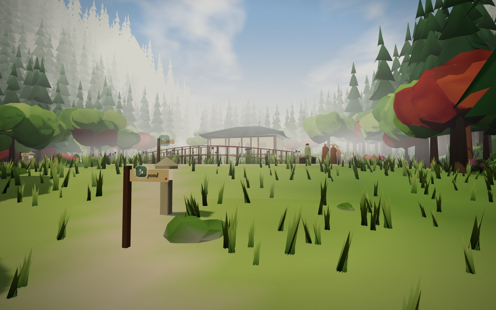
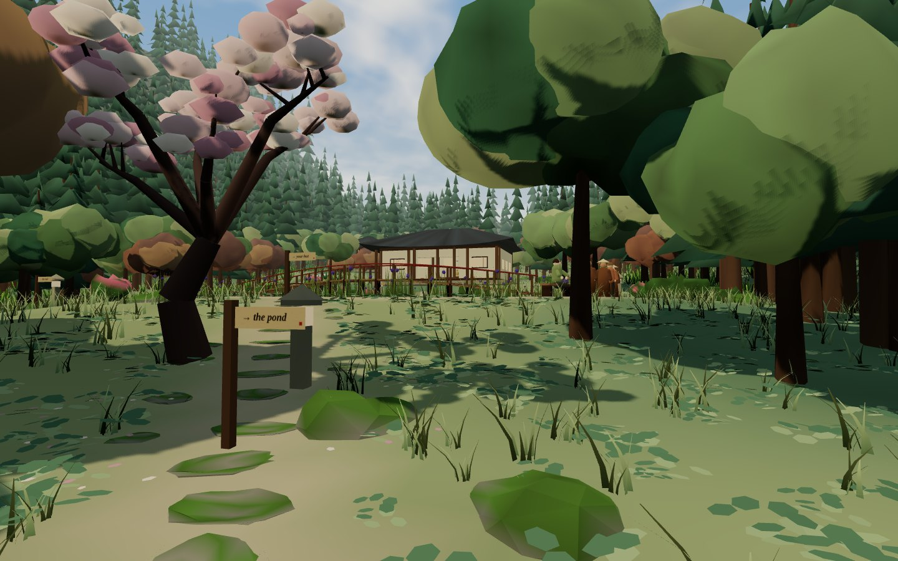
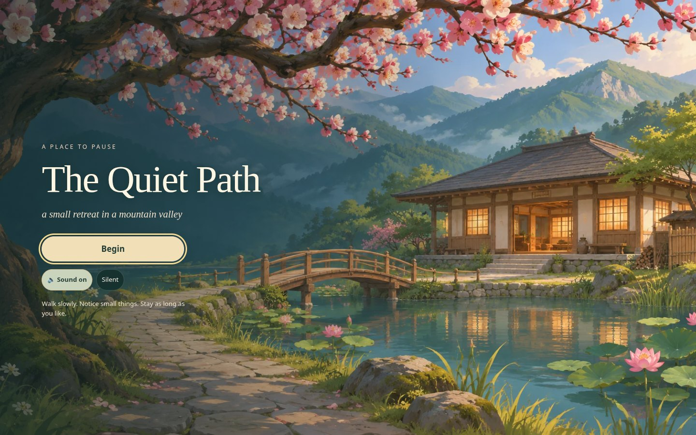
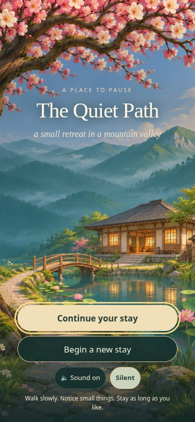
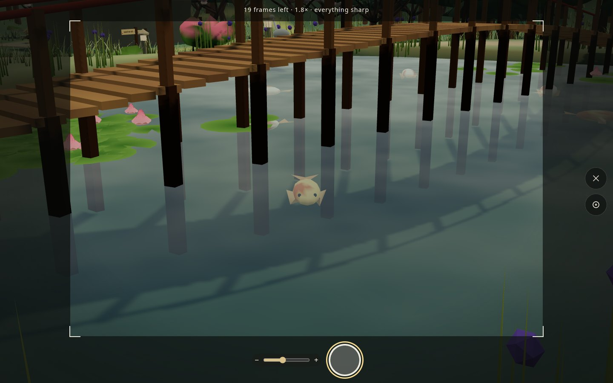
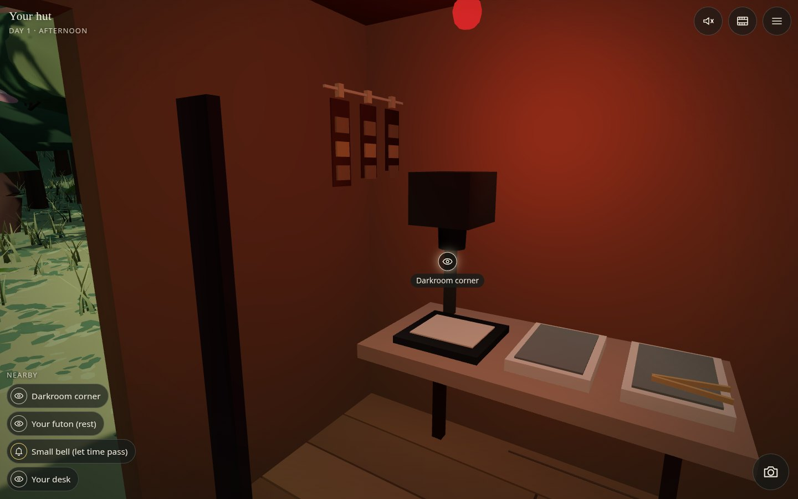

# Plum Light · class iteration

An original art pass on `main` at `18fa928` (November 3, 2026). Play with `npm run dev`; the application lives under `/the-quiet-path/`. See the new opening, then Continue an existing stay or walk down from the gate. The main landscape improvements begin outside the hut and follow the stepping stones toward the pond. Watch the koi from the bank or bridge; raise the camera and look down into open water.

## Same place, same lens

Both captures use the latest-main scene at `(x: 19, z: 38)`, eye height `groundAt + 1.62 m`, yaw `0.283`, pitch `0.04`, FOV `62°`, viewport `1440 × 900`, high quality, day 1 / afternoon / mist. UI is hidden in the after image to make the landscape easy to compare. This reconstructs the supplied “Outside your hut” composition; it is not a pixel-exact reproduction of the supplied screenshot. The before image comes from an untouched archive of `18fa928`, before the art edits.

| Before | After |
| --- | --- |
|  |  |

## Opening artwork

Two original compositions, not one aggressively cropped image. Text and controls remain live HTML. The desktop example is a new stay; the phone example includes an existing save. Both use locally served WebP artwork and work without external fonts through serif/system fallbacks. The still artwork has no animated effects; reduced motion also removes the entrance fade. The hidden 3D world does not render behind the title.

| Desktop · 1440 × 900 | Phone · 390 × 844 |
| --- | --- |
|  |  |

## Looking closely

| Pond photography | Hut darkroom |
| --- | --- |
|  |  |

[Actual saved fish JPEG](fish-saved.jpg) · [Fish-hidden control exposure](fish-hidden-control.jpg) · [Hall floorboards and cushions](hall-interior.jpg) · [Phone playable view](hut-phone.jpg)

Fish are meshes below the transparent water, rather than an overlay on the screen. They therefore appear in the offscreen film renderer, thumbnails and saved JPEGs. The test takes a real exposure, hides the fish, then takes a control exposure at the same pose. Large pixel differences beyond the changing film grain confirm fish visibility. Water reflections represent the sky and sunlight; this iteration does not add an expensive reflected-world render pass.

## Verification and limits

Run `npm run build`, then `npm run preview -- --host 127.0.0.1 --port 5175 --strictPort`, then `python scripts/art-pass-smoke.py`. The optional smoke script requires Python Playwright, Pillow and Chromium; it adds no application dependencies. `QUIET_PATH_URL` and `CHROMIUM` can select another preview host and browser executable. The script uses isolated browser storage and writes the review images plus [`checks.json`](checks.json). Local navigation/poses use the existing `window.__game` debugging object; keyboard and touch controls, title choices, shutter and album use their real handlers.

The checks run against the production bundle under the GitHub Pages repository path, in Chromium with software WebGL. They cover Begin/Continue, existing v2 progress and film roll, canceling a new stay, navigation routes, keyboard exploration, touch drag / ground tap / Stop / camera controls, look dialogs, fish movement and persisted photography, reduced motion, and desktop / phone layouts. This is browser emulation, not a physical iOS/Android performance measurement. No deployment is performed.

## Asset approach and follow-up

Vegetation remains instanced and building/figure details remain merged geometry. Hero plums and pond fish are retained at low quality. Original title art is about 521 KB for both orientations combined; the browser requests the matching orientation. Source/provenance: [`public/art/README.md`](../../public/art/README.md), [`CREDITS.md`](../../CREDITS.md). The retreat, people and architecture are fictional; no new details are presented as authentic Plum Village artifacts or practice guidance.

Follow-up playtesting: physical-phone frame times, broader seasonal blossom changes, more varied walking/seated character animation, finer hand-painted bark/wood textures, additional hut possessions and orchard tools. These are deferred refinements; the title, hut-to-pond view, fish and first-pass interior props are integrated now.
